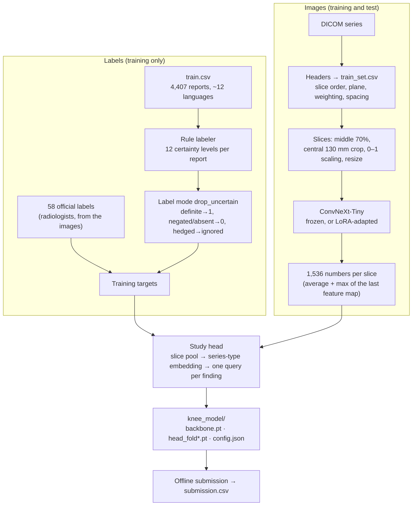
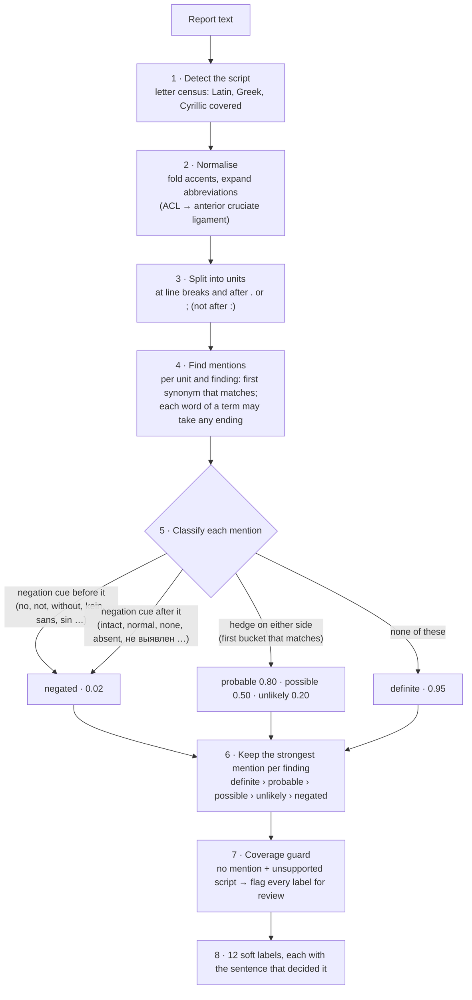
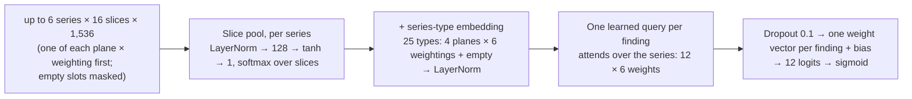

# RSNA Knee Abnormality Detection

My entry to the [RSNA Knee Abnormality Detection](https://www.kaggle.com/competitions/rsna-knee-abnormality-detection) Kaggle competition (2026). The task is to predict 12 findings for each knee MRI study. Each finding is scored by ROC AUC, and the leaderboard score is the mean of the 12.

The pipeline:

1. A rule-based, multilingual report labeler turns every training report into 12 labels.
2. The 58 studies with official labels override those labels.
3. ConvNeXt-Tiny describes every MRI slice. It is either frozen or fine-tuned with LoRA.
4. A study-level attention head turns all the slices of all the series of a study into 12 probabilities.
5. The submission runs offline from a saved model.

This repository is the competition notebook reorganised as a Python package. The logic is unchanged: [`tests/check_equivalence.py`](tests/check_equivalence.py) runs the notebook and the package on the same data and checks that they write identical files.

## Results

| Version | Backbone | What changed | Public LB |
| --- | --- | --- | --- |
| 1 | DINOv2 ViT-S/14, frozen | One head per series, report labels | 0.599 |
| 2 | DINOv2 ViT-S/14, frozen | Study-level head with plane × weighting embedding, middle 70% of slices, CLS + mean-patch features, labeler fixes, hedged labels dropped | 0.612 |
| 3 | ConvNeXt-Tiny, frozen | 130 mm physical crop, average + max features, the 58 official labels (8× weight) | **0.653** |
| 4 | ConvNeXt-Tiny + LoRA | Adapters fine-tuned end to end with the head | not scored |

For comparison, other entries reported these public scores: a public community stack of fine-tuned 2.5D models reached about 0.944, and independent single models fine-tuned end to end reached 0.86 to 0.93 ([sources](#sources)). [Limitations](#limitations-and-what-would-move-the-score) explains where the gap comes from.

## Contents

- [How it works](#how-it-works)
- [Data](#data)
- [Labels from reports](#labels-from-reports)
- [Image model](#image-model)
- [Training](#training)
- [Offline submission](#offline-submission)
- [Technical specifications](#technical-specifications)
- [Repository layout](#repository-layout)
- [Quick start](#quick-start)
- [Verification](#verification)
- [Limitations and what would move the score](#limitations-and-what-would-move-the-score)
- [Sources](#sources)

## How it works



Labels are needed only for training. The image path is the same for training and test, so the submission reuses the saved backbone and head without the reports.

## Data

The competition provides 4,407 training studies with free-text radiology reports in about 12 languages from 16 sites. Only 58 of them carry the official labels that the test set is scored against. Those labels come from expert radiologists reading the images, are thresholded by severity, and count borderline cases as negative.

| File | What it holds | Used for |
| --- | --- | --- |
| `train.csv` | `StudyInstanceUID`, `Report`, 12 label columns (filled for 58 studies) | report labels, official labels |
| `train_series.csv`, `train_series/` | one row per series; the DICOM files of every study and series | `train_set.csv`, slice features |
| `test.csv`, `test_series.csv`, `test_series/` | test studies, without reports. The visible set is a stub; the hidden rerun replaces it. | `submission.csv` |
| `sample_submission.csv` | the id column and the 12 finding columns, in order | column names and order |
| `train_set.csv` (built here) | one row per series: ordered file paths, slice count, plane, weighting, pixel spacing, report labels | the training frame |

How a series is read (`data/dicom.py`):
- Only headers are read (`stop_before_pixels`). Pixels are read later, a few sampled slices at a time.
- Slices are ordered by their position along the slice normal (from `ImageOrientationPatient` and `ImagePositionPatient`), then by `InstanceNumber`, then by file name.
- The plane comes from the slice normal: sagittal, coronal or axial when one axis has at least 0.75 of it, otherwise oblique.
- The weighting (PD, T1, T2, STIR, T2*, FLAIR, localizer) comes from keywords in `SeriesDescription`, falling back to repetition and echo time. Localizers are dropped.

## Labels from reports

### The rule-based labeler (`labeling/rules.py`)

The labeler has no model and needs no network or GPU; it is plain Python. Everything language-specific (terms, negation cues, hedges, abbreviations) lives in one `Vocabulary`. The algorithm is the same for every language, and adding a language means adding vocabulary only. It covers English, German, French, Spanish and Dutch, plus Russian and Greek stems.



**Scope of a cue.** A cue only counts inside the mention's unit, up to 80 characters on either side. The scope is cut at `, ; :` and at *but, however, aber, jedoch, mais, pero, maar, но, αλλα*, so "No fracture, but ACL torn" does not negate the ACL. A colon right after the term is kept, so "ACL: intact" negates the ACL. Negation is checked before hedges, so "no possible tear" is negated.

**Hedge buckets.** They are tried in order:
- **probable:** likely, probable, consistent with, suggestive of
- **possible:** possible, cannot be excluded, suspicion, query, may represent, versus
- **unlikely:** unlikely, doubtful

### One report, traced

The values below are the labeler's real output for this report (also checked in `tests/test_labeler.py`):

```text
FINDINGS: Complete tear of the ACL. MCL: intact. Possible tear of the posterior horn of the medial meniscus.
Small joint effusion. No fracture, but bone bruise of the lateral femoral condyle. Patellofemoral cartilage
is preserved. Small Baker's cyst. Possible synovitis.
IMPRESSION: ACL rupture with bone contusion. Medial meniscus tear.
```

| Unit | Mention | Cue | Certainty |
| --- | --- | --- | --- |
| Complete tear of the ACL. | ACL | none | definite |
| MCL: intact. | MCL | after: *intact* | negated |
| Possible tear of the … medial meniscus. | medial meniscus | hedge: *possible* | possible |
| Small joint effusion. | effusion | none | definite |
| No fracture, but bone bruise … | fracture | before: *no* | negated |
| (same unit, after *but*) | bone contusion | none (scope cut at *but*) | definite |
| Patellofemoral cartilage is preserved. | patellofemoral OA | after: *preserved* | negated |
| Small Baker's cyst. | Baker's cyst | none | definite |
| Possible synovitis. | synovitis | hedge: *possible* | possible |
| ACL rupture with bone contusion. | ACL, bone contusion | none | definite |
| Medial meniscus tear. | medial meniscus | none | definite (wins over *possible*) |

The result is 5 positives (ACL, medial meniscus, effusion, Baker's cyst, bone contusion), 6 negatives and 1 ignored label (synovitis).

### From labeler output to training target

| Labeler certainty | Example | Soft value | Target (`LABEL_MODE = "drop_uncertain"`) |
| --- | --- | --- | --- |
| definite | "Complete tear of the ACL" | 0.95 | 1 |
| probable | "Findings consistent with MCL sprain" | 0.80 | ignored |
| possible | "Possible synovitis" | 0.50 | ignored |
| unlikely | "Fracture doubtful" | 0.20 | 0 |
| negated | "MCL: intact", "No fracture" | 0.02 | 0 |
| not mentioned | the finding never appears | 0.02 | 0 |
| script not covered | no finding found, report not in Latin, Greek or Cyrillic | 0.02, flagged | no labels; the study is dropped unless it has official labels |
| official label | a radiologist's read of the images (58 studies) | 0 or 1 | replaces the report label; weighs 8× in the frozen path's loss |

`LABEL_MODE = "soft"` trains on the soft values instead. `RELABEL_FROM_REPORTS = True` recomputes the labels from `train.csv` at the start of training, so labeler fixes apply without rebuilding `train_set.csv`.

**Fixes made during the competition.** A 34-sentence check went from 17 wrong to 0 (`tests/test_labeler.py`). The original labeler:
- never matched *Baker's cyst* or *Baker’s cyst*;
- never matched *medial / lateral meniscal tear* or *tibial collateral ligament*;
- read *ACL: intact*, *Effusion: none* and *Fracture: absent* as positive, because a colon ended the unit before the cue.

**Known gaps:**
- The probable cue *likely* also matches inside *unlikely*, so "ACL tear is unlikely" reads as probable (0.80). With `drop_uncertain` it is ignored rather than counted as 0. A test documents this.
- The labeler records no severity, while the official labels count borderline findings as negative. So "Small joint effusion" is a training positive that a radiologist may grade negative.

### The LLM reader (`labeling/llm.py`, optional)

Qwen3-8B reads each report and answers *present / uncertain / absent / not_mentioned* for every finding, quoting its evidence, as JSON. These answers map to 1.0 / 0.6 / 0.0 / 0.2.
- **How it runs:** reports are batched, and the batch size halves automatically on out-of-GPU-memory errors.
- **Parsing:** finding names and statuses are matched loosely (case, spaces, *Baker's*).
- **Thinking off:** the reader sets `enable_thinking=False`, so Qwen answers with the JSON directly instead of writing a long reasoning block first.
- **Status:** it was built and run during the competition, but training uses the rule-based labels. `scripts/label_reports_llm.py` writes `llm_labels.csv` for comparison.

## Image model

### Per slice: ConvNeXt-Tiny (`training/frozen.py`)

| Step | Detail |
| --- | --- |
| Slices | 16 (frozen path) or 12 (LoRA), evenly spaced in the middle 70% of the series |
| Crop | the central 130 mm × 130 mm, from `PixelSpacing`, so every scanner shows the knee at the same physical scale. A smaller field of view keeps the whole slice. |
| Intensity | per-volume 1st to 99th percentile scaled to 0–1, then standardised with ImageNet's grey mean and std (0.449, 0.226) |
| Resize | 288 × 288 (frozen) or 224 × 224 (LoRA), bilinear |
| Backbone | `convnext_tiny.fb_in22k_ft_in1k` (timm): 27.8 M parameters, ImageNet-22k pretrained, stem folded to one grey channel. 4 stages of 3, 3, 9, 3 blocks, widths 96 / 192 / 384 / 768. |
| Features | the last feature map (768 × 9 × 9 at 288 px): its global average and its maximum, each through the head's LayerNorm and then joined, **1,536 numbers per slice**. The average describes the slice; the maximum keeps a small bright spot, such as oedema. |

### Per study: the study head (`StudyHead`, 278,285 parameters at 1,536 features)



Each finding chooses which series to read. ACL can lean on the sagittal PD and effusion on the axial, and a series that shows nothing relevant gets little weight. The attention weights (slices per series, series per finding) can be read out with `return_weights=True`.

## Training

### Shared preparation (`prepare_training_frame`)

1. Read `train_set.csv`, recompute the report labels, and drop localizers.
2. Split the studies (`data/splits.py`): 15% hold-out, and 5 folds of the rest, stratified by label pattern and grouped by study.
3. Exempt the 58 official studies from the unreadable-report drop, and spread them evenly over the 5 folds.

### Path A: frozen backbone (`train_frozen`, `--method frozen`)

1. **Features:** every series is embedded once and cached as `float16` (`FEATURE_CACHE`). The cache is matched by series id, so reordered inputs reuse it.
2. **Heads:** one study head per fold trains on the cached features:
   - AdamW, learning rate 1e-3, weight decay 1e-4, 10% warm-up then cosine decay;
   - 32 studies per step, up to 40 epochs, early stop after 8 epochs without a better validation AUC;
   - BCE over known labels only, with official studies weighted 8×;
   - augmentation: each step uses a random 75% of the slices and hides each series with probability 0.2 (never all of a study's series).
3. **Output:** `head_fold0.pt` to `head_fold4.pt`, `backbone.pt` and `config.json`, plus a diagnosis table (below).

### Path B: LoRA fine-tuning (`train_lora`, `--method lora`, the default)

The frozen backbone sees MRI exactly as an ImageNet model would. LoRA lets it adapt cheaply. The adapters are low-rank (rank 8, alpha 16, scale 2) and wrap `fc1` and `fc2` of every block in stages 2 and 3, which is 12 of the 18 blocks and 24 linear layers, about 460,800 parameters. Only the adapters and the study head train; the 27.8 M pretrained weights stay frozen.

| | |
| --- | --- |
| Data | every slice is prepared once (crop, scale, resize, exactly as for the submission) into a `uint8` memory-mapped file (`SLICE_CACHE`); epochs read that file, not the DICOMs. The disk is checked first; if space is short, fewer slices are cached. |
| Step | up to 6 series × 12 slices per study through ConvNeXt + LoRA → features → study head → BCE. Gradients reach both. |
| Optimiser | AdamW: adapters 2e-4 (no weight decay), head 1e-3; warm-up then cosine; fp16 autocast with gradient scaling on GPU; gradient clipping at 1.0 |
| Augmentation | brightness ×0.9–1.1 and ±0.05, a shift of up to 1/28 of the image, a random 75% of the slices, series hidden with probability 0.2. No flips, because left and right matter. |
| Length | up to 8 epochs; no new epoch after 6 hours |
| Validation | fold 0 picks the best epoch. The 58 official studies are scored every epoch but never trained on (`FT_TRAIN_ON_GOLD = False`), which keeps an honest estimate of the leaderboard. |
| Saving | at every new best epoch, the adapters are merged into the weights (W + scale · B·A) and saved as an ordinary `backbone.pt`, with `head_fold0.pt` and `config.json`. The submission needs no LoRA code. After training, the merged and adapted models are compared (difference < 1e-3). |

One model is trained instead of five because five fine-tuned backbones would mean five passes over the test DICOMs at submission.

### Diagnosis

Both paths print a per-finding table against two kinds of labels:

| Column | Against | Tells you |
| --- | --- | --- |
| `oof_auc` / `val_auc` | report labels, out of fold | what cross-validation measures |
| `report_vs_gold` | official labels | how well the reports agree with them: a ceiling for learning from reports |
| `model_vs_gold` / `official_auc` | official labels, out of fold | the closest estimate of the leaderboard |

With 58 studies, one finding's AUC moves by about 0.1 by chance. Read the means and the pattern, not single cells.

## Offline submission

`predict()` (`predict.py`, `scripts/predict.py`) runs with no Internet:

1. Load `config.json`. It restores the crop, slice window, slice count, feature type and series cap the model was trained with.
2. Build the backbone from `backbone.pt` (nothing is downloaded) and the heads from `head_fold*.pt`.
3. Read the test series headers. Unreadable series are skipped, and localizers are dropped.
4. Embed the test slices with the same preparation as training.
5. Group them into studies and average the probabilities of all fold heads.
6. Map the model's label names to the competition's columns (by name, else by position), and fill studies without a readable series with the column mean.
7. Write `submission.csv`.

When `KAGGLE_IS_COMPETITION_RERUN` is set (Kaggle's hidden-test rerun), `config.TRAIN` is forced to `False`.

## Technical specifications

### Settings (`src/rsna_knee/config.py`)

All settings live in one module. Code reads them at call time, so `config.update(NAME=value)` or `--set NAME=VALUE` on any script changes them everywhere.

| Setting | Value | Effect |
| --- | --- | --- |
| `cfg.model_name` | `convnext_tiny.fb_in22k_ft_in1k` | backbone (timm) |
| `cfg.n_slices`, `cfg.image_size` | 16, 288 | frozen path: slices per series, pixels per side |
| `cfg.batch_size`, `cfg.num_workers` | 8, all CPUs | series per feature-extraction batch, DICOM reader processes |
| `cfg.epochs`, `cfg.patience` | 40, 8 | frozen-path head training and early stopping |
| `cfg.head_lr`, `cfg.weight_decay`, `cfg.dropout` | 1e-3, 1e-4, 0.1 | head optimiser |
| `cfg.warmup_frac`, `cfg.grad_clip`, `cfg.seed` | 0.1, 1.0, 42 | schedule, clipping, seed |
| `HEAD_BATCH` | 32 | studies per step (frozen path) |
| `SLICE_KEEP`, `SERIES_DROP` | 0.75, 0.2 | augmentation |
| `CENTER_FRAC` | 0.7 | slices come from the middle 70% of a series |
| `CROP_MM` | 130 | central crop in millimetres (`None` = no crop) |
| `FEATURE_MODE` | `avg+max` | 1,536 numbers per slice (`avg`: 768) |
| `MAX_SERIES` | 6 | series per study the head sees |
| `DROP_LOCALIZERS` | True | scout series are left out |
| `LABEL_MODE` | `drop_uncertain` | hedged report labels ignored (`soft`: use soft values) |
| `RELABEL_FROM_REPORTS` | True | labels recomputed from `train.csv` |
| `USE_GOLD`, `GOLD_WEIGHT` | True, 8.0 | official labels used, and their loss weight |
| `FINETUNE` | True | default training path: LoRA (`False`: frozen) |
| `LORA_RANK`, `LORA_ALPHA`, `LORA_STAGES` | 8, 16, (2, 3) | adapters |
| `FT_SLICES`, `FT_IMAGE` | 12, 224 | LoRA path: slices per series, pixels per side |
| `FT_EPOCHS`, `FT_BATCH` | 8, 4 | LoRA epochs, studies per step |
| `FT_LR_LORA`, `FT_LR_HEAD` | 2e-4, 1e-3 | learning rates |
| `FT_VAL_FOLD`, `FT_TRAIN_ON_GOLD` | 0, False | validation fold; official studies held out |
| `FT_TIME_LIMIT_H` | 6.0 | no new epoch after this many hours |
| `DATA_PATH`, `TRAIN_SET_CSV`, `MODEL_DIR`, `FEATURE_CACHE`, `SLICE_CACHE` | Kaggle paths on Kaggle, `./data` and `./outputs` elsewhere | override with `--data` etc. or `KNEE_DATA_PATH`, `KNEE_TRAIN_SET_CSV`, `KNEE_MODEL_DIR`, `KNEE_FEATURE_CACHE` |

### Model sizes

| Part | Parameters | Trained |
| --- | --- | --- |
| ConvNeXt-Tiny backbone | 27.8 M | no (frozen path); only adapters (LoRA path) |
| LoRA adapters | about 460,800 | LoRA path |
| Study head (1,536 features) | 278,285 | yes |

### Saved model (`knee_model/`)

| File | Content |
| --- | --- |
| `backbone.pt` | timm `state_dict` of ConvNeXt-Tiny (LoRA merged in, if fine-tuned) |
| `head_fold{k}.pt` | `StudyHead` `state_dict`: 5 folds (frozen) or 1 (LoRA) |
| `config.json` | `model_name`, `image_size`, `n_slices`, `in_chans`, `dim`, `dropout`, `feature_mode`, `center_frac`, `crop_mm`, `max_series`, `planes`, `weightings`, `label_mode`, `labels`, `folds`, `drop_localizers`, `cv_auc`, plus official-label AUCs and, for LoRA, the adapter settings |

### Runtime and hardware (Kaggle, 2× T4)

| Step | Time | Notes |
| --- | --- | --- |
| `build_train_set.py` | an hour or more | reads every DICOM header once |
| Frozen-path features | one pass over the DICOMs | after that, seconds per head epoch |
| LoRA | one pass to prepare slices, then roughly 10–15 min per epoch | the cell prints seconds per step after 20 steps. The cache needs about 0.6 MB per series. |
| Submission | one pass over the test DICOMs | must fit Kaggle's 9-hour limit with Internet off |

The LoRA epoch time is an estimate, not a measurement.

## Repository layout

```text
src/rsna_knee/
  config.py             every path and setting (notebook cell 0 + the settings of cells 12-14)
  cli.py                --data, --model-dir, --set NAME=VALUE ... for the scripts
  labeling/rules.py     rule-based multilingual labeler (cell 3)
  labeling/llm.py       Qwen3-8B report reader (cell 1)
  data/download.py      Kaggle download (new)
  data/dicom.py         DICOM headers, slice order, plane/weighting, reports, build_dataset (cell 6)
  data/splits.py        hold-out + 5 folds, grouped by study (cell 10)
  training/common.py    TrainConfig, dataset, slice sampling, attention pool, metrics (cell 11)
  training/frozen.py    features, study head, official labels, frozen-path training (cell 12)
  training/lora.py      LoRA fine-tuning (cell 13)
  predict.py            offline submission (cell 14)
  legacy/               earlier notebook code the pipeline no longer uses (cell 0's DICOMExtractor,
                        cell 11's end-to-end DINOv2 trainer)
scripts/
  download_data.py      competition data, datasets, models from Kaggle
  build_train_set.py    train_set.csv (cells 7-9)
  label_reports_llm.py  LLM labels (cell 2)
  train.py              --method lora | frozen (cells 12-13)
  predict.py            submission.csv (cell 14)
notebooks/
  rsna-knee-abnormality.ipynb          the self-contained competition notebook
  kaggle_submit_with_package.ipynb     submission on Kaggle using this package
tests/                  labeler, downloader, and notebook-vs-package equivalence
tools/                  the converter that made src/ from the notebook
```

## Quick start

```bash
git clone <this repo> && cd rsna-knee-abnormality
pip install -e ".[dev]"          # or: pip install -r requirements.txt

# 1. Data: sign in to Kaggle, accept the competition rules on its page once, then
export KAGGLE_API_TOKEN=...      # or ~/.kaggle/access_token, ~/.kaggle/kaggle.json, `kaggle auth login`
python scripts/download_data.py --csv-only     # reports, labels, series lists (small)
python scripts/download_data.py                # everything, including all DICOMs (large)

# 2. Training frame (reads every DICOM header once)
python scripts/build_train_set.py

# 3. Train: LoRA by default, or the frozen path
python scripts/train.py
python scripts/train.py --method frozen
python scripts/train.py --set FT_EPOCHS=5 --set FT_BATCH=2        # any setting in config.py

# 4. Submission
python scripts/predict.py --model-dir outputs/knee_model --out submission.csv
```

**On Kaggle**, there are two ways:
- run `notebooks/rsna-knee-abnormality.ipynb` as it is (`TRAIN = True` to train with Internet on, `TRAIN = False` to submit);
- or upload this repository and a trained `knee_model/` as datasets and submit with `notebooks/kaggle_submit_with_package.ipynb`.

The downloader also fetches your own uploads:
- a dataset: `--dataset owner/name`, for example `ask5898/train-set`;
- a model: `--model owner/model/pytorch/default/1`.

## Verification

```bash
pytest -m "not slow"                  # labeler (34 sentences, worked example) and downloader: seconds
python tests/check_equivalence.py     # notebook vs package, frozen and LoRA paths: about 2 minutes on a CPU
```

`check_equivalence.py` builds a small synthetic competition folder (`tests/make_synthetic_data.py`: 70 training studies, 15 with official labels, 4 test studies, one unreadable). It then runs the notebook, cell by cell, and the package scripts, each in its own process with the same settings. Both use a seeded random initialisation in place of the pretrained weights, so no download is needed.

The results match exactly (maximum difference 0.0):
- `train_set.csv`;
- the frozen path's `submission.csv`;
- the LoRA path's `submission.csv`.

The package's submission runs in a fresh process, so this also checks that a saved model restores its own settings.

How the package was made from the notebook (`tools/notebook_to_package.py`): each cell's code is copied unchanged, except for these edits:
- **Settings:** settings move to `config.py`. A scope-aware rewrite changes only references to the shared global, never a local or parameter of the same name.
- **Functions:** the notebook's `if TRAIN` blocks and prediction block become `train_frozen()`, `train_lora()` and `predict()`.
- **Defaults:** defaults that captured a path when defined now resolve it when called.
- **Imports:** explicit imports replace the notebook's shared namespace.

## Limitations and what would move the score

- **Labels.** Report labels are a proxy. Another team's report labeler reached 0.79 AUC against the official labels, and an LLM extractor about 83% agreement. Ours records no severity.
- **Backbone.** The frozen path never adapts ConvNeXt to MRI. The LoRA path does, but on one-channel 2D slices and report labels, and it was not scored.
- **Input.** Top entries feed three neighbouring slices as one 2.5D input, reorient every series to one standard view, resample to a fixed mm per pixel, and ensemble several fine-tuned models.
- **Series typing.** Weighting comes from description text in about 12 languages. The competition's own `train_series.csv` flags (plane, fluid-sensitive, fat-suppressed) would be more reliable.

## Sources

- [RSNA Knee MRI AI Challenge announcement](https://www.rsna.org/news/2026/august/ai-challenge-knee-mri): dataset size, the expert-annotated test set
- [homeshwarnelakurthi/RSNA-Knee-Abnormality-Detection](https://github.com/homeshwarnelakurthi/RSNA-Knee-Abnormality-Detection): 58 of 4,407 studies labelled, severity-thresholded labels, report labeler at 0.79 AUC against them
- [aditbytes/kaggle-rsna-knee-abnormality](https://github.com/aditbytes/kaggle-rsna-knee-abnormality): leaderboard bands, single-model scores of 0.86 to 0.93
- [Inside the pipeline that placed 18th (Hugging Face blog)](https://huggingface.co/blog/bishnoiyash/rsna-competetion): a fine-tuned EfficientNet-B3 at 0.903, report extraction at about 0.83 agreement
- [pilkwang, rsna-knee-baseline-v1](https://www.kaggle.com/code/pilkwang/rsna-knee-baseline-v1) and [goodpjw2008, the 0.944 public stack](https://www.kaggle.com/code/goodpjw2008/rsna-knee-stack-2-5d-convnext-mil-lb-0-944): the 130 mm crop, 2.5D windows, the series flags
